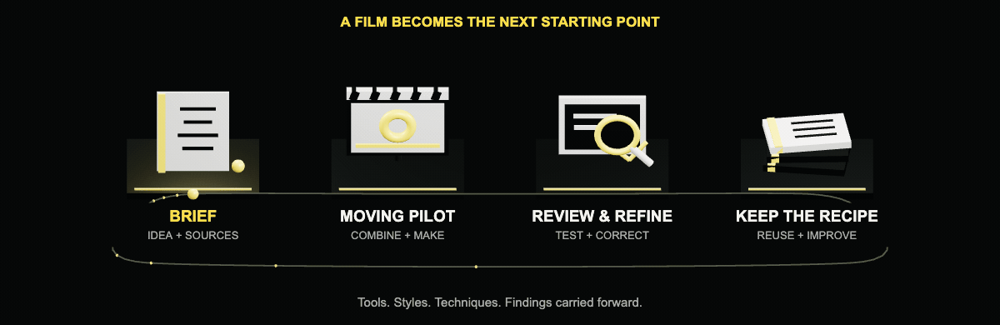

# Framewright

[](https://markoblogo.github.io/framewright/)

[](https://github.com/markoblogo/framewright/releases)
[](LICENSE)

**Research-driven filmmaking. Every production adds to the method.**

Framewright is an independent creative studio and production lab by
[Anton Biletskiy-Volokh](https://abvx.xyz). I create films, explainers and visual
experiments while investigating how **AI tools, visual styles and production
techniques work together**.

The research unit is a real production: a creative result, the combination of
tools and techniques behind it, and the revisions that made it work. Findings,
failures and useful corrections are retained as recipes and checks for later
projects. The process grows through practical work and human review.

**The ambition is creative freedom across styles and toolsets**: build the right
approach for the idea, with technical feasibility, access, time and budget guiding
what can be achieved. This is an open-ended research direction, not a claim to
have tested every tool or solved every kind of scene. Current capabilities and
limits are linked to actual cases below.

[Watch the work](https://markoblogo.github.io/framewright/#work) ·
[Work with me](https://markoblogo.github.io/framewright/#contact) ·
[Explore the methods](docs/start-here.md)

## Three ways to work together

### Make a film

For brands, authors and organisations with a product to explain, a story to tell
or a visual idea to explore. Discuss a film, explainer, product story or media-art
piece, with creative direction, sound and a publication-ready package composed
for the selected screens.

[Discuss a creative project](https://markoblogo.github.io/framewright/#contact).

### Test a tool in real production

For AI platforms and creative-tool developers. Explore a partnership built around
a concrete production question: use the product in a real project, retain the
results and limitations, and develop a review or demonstration from that work.
When a tool proves useful, it can also become part of a documented production
recipe rather than disappearing after one review.

Partner access is an opportunity to test, not a guarantee of a recommendation.
Testing scope, editorial independence and any compensation or affiliate
relationship should be agreed and disclosed. Audience results and sales are not
promised.

[Propose a tool partnership](https://markoblogo.github.io/framewright/#contact).

### Build on the process

For content teams and production studios: discuss a repeatable AI-assisted video
workflow, including tool selection, review steps and reusable recipes, scoped
to your production needs and available tools.

For fellow creators and agent-assisted developers: explore the open repository,
adapt the methods and contribute observations. Start with a
[production plan](docs/start-here.md#start-a-film), a
[worked correction](docs/productions/pantheon-chatgpt-orb.md#worked-example-v2-to-v3)
or the [task/style/tool search](skills/video-production-router/references/arsenal-search.md).

## See the work and what it taught us

| Work | Production lesson |
| --- | --- |
| [Same Ticker, Different Rights](https://youtu.be/NQX0F57Iy7g) | A glossy animated financial magazine combining sourced product material with distinct explanatory scenes. [Case and revisions](docs/productions/kriptok-same-ticker.md). |
| [I See You as Art](https://youtu.be/hb9oYAK37w4) | Media art made from supplied calligraphy footage and photographs, with music and separate screen compositions. [Sources and method](docs/productions/i-see-you-as-art-pl1.md). |
| [The Last Seed](https://youtu.be/ZQTORLBw9Zs) | An original Blender short refined through precise contact, mechanism, rain and sound corrections. [Worked case](docs/experiments/last-seed-recovery.md). |
| [This World Unfolds](https://youtu.be/eWheRM41ZaU) | A real browser-world recording shaped into two formats, with portrait reframing and source-aware sound work. [Case and limits](docs/productions/papertrails-world-walk.md). |

Publication links are owner-reported; individual case records distinguish
technical checks, creative decisions, rights and publication. Views, revenue and
uploaded-file identity are not inferred from a link.

## How the studio learns

**Brief → moving pilot → review and refine → retain the useful recipe.**



Framewright explores combinations of generation, code animation, 3D, real footage,
screen capture, sound and local editing according to the scene. A tool is assessed
in context: what it contributes to the chosen style, how it works with the rest
of the pipeline and how precisely the result can be revised. The methods keep sources, selected
versions, corrections and known limits connected, so a later project can build on
actual work rather than repeat the same discovery.

Public methods and original repository materials are open; private project
assets, client material and confidential partner terms are not. External tools,
models and media retain their own licences. [Purpose and development path](docs/vision.md) ·
[Studio Notes](docs/editorial/README.md).

## Use Framewright yourself

Today the open project is an **experimental methods and agent-skills library**.
An agent uses selected tools in your environment; this repository is not a hosted
renderer or an automatic publishing service. Start with the task you need:

## Start / continue / correct

| Your task | Begin here | What you get |
| --- | --- | --- |
| **Start a film** | [Brief and production proposal](docs/start-here.md#start-a-film) | A concept, available sources/gaps, feasible route, constraints and a small pilot |
| **Continue a project** | [Recover the current state](docs/start-here.md#continue-a-project) | Exact selected version, accepted work, waits/blockers and the next permitted step |
| **Correct a fragment** | [Bounded change and A/B review](docs/start-here.md#correct-a-fragment) | A precise request, preserved original and corrected version, comparison in context |

[Purpose and development path](docs/vision.md) · [Current priorities](docs/next-cycle.md) · [Strategic roadmap and release gates](docs/roadmap.md)

## Try one production plan

From a local checkout with Python3, without additional Python packages:

```sh
python3 skills/video-production-router/scripts/plan.py examples/briefs/mixed-promo.json --format markdown
```

This prints a plan; it does not render, install, call a model or spend money.
[Example output](examples/plans/mixed-promo.md) · [Agent setup](docs/production-guide.md#use-the-agent-skill).

<details>
<summary>Current capabilities, evidence and earlier results</summary>

## Current state

| Scope | Evidence and boundary |
| --- | --- |
| Source version | **0.11.0** · [source release notes](docs/release-notes-0.11.0.md) · [published builds and checksums](https://github.com/markoblogo/framewright/releases). |
| Review and exchange | Selected-version continuation,explicit replaced-review history,seekable local media review,versioned corrections and the existing owner-approved Radar status flow; [review method](docs/methods/native-editor-before-render.md). Selection, generation and publication remain agent-and-owner work. |
| Single-brief production tests | [Same Street, Three Moods](docs/productions/same-street-three-moods.md) revised for tempo/ground contact; [One Light, One Way Home](docs/productions/one-light-one-way-home.md) revised for scene motion. Both revision2 films are accepted after corrections, with owner-supplied YouTube/TikTok publication links. No requested mid-run assistance; prepared setup, unsolicited owner messages and timing limits retained in [AUTOPROD-01](docs/experiments/autonomous-production-pilot.md). |
| Physical-tablet finishing | [InShot feature exports](docs/experiments/inshot-functions-2026-11-13.md) and the accepted [Babylon tour](docs/productions/babylon-virtual-tour.md); [companion-app results](docs/experiments/android-companions-2026-11-13.md). Source-frame rate, endpoint timing and incomplete app tests remain explicit. |
| REL-C evidence | Completed character fiction, bounded continuity/contact/correction, two aspect layouts and independent same-case recovery; [assessment](docs/rel-c-readiness-2026-11-04.md) and [review](docs/rel-c-independent-review-2026-11-04.md). Agent-and-human-led manual workflow; no general rig or autonomous route claim. |
| REL-B evidence | [Assessment](docs/rel-b-readiness-2026-11-01.md): both formats accepted, scoped recovery/reuse/correction; [local checks/review](docs/rel-b-local-review-2026-11-01.md) and PR50/merged-main CI pass. No labour-savings or whole-route-autonomy claim. |
| SSI handoff | [6 November cycle, owner report](docs/productions/ssi-2026-11-06.md): three films, deployment and six Telegram confirmations. Partner creative/listening acceptance, public publication and the15November unattended outcome remain separate. |
| AzurMenton guide pilot | [40s guide film](docs/experiments/azur-guide-first-film.md) accepted; YouTube and guide embed owner-reported. A general automated guide template is not yet qualified. |

Private projects/media remain outside Git; follow the [external-storage and cleanup policy](docs/storage-policy.md).
Technical QA, creative/listening
acceptance, rights and publication are separate records. Labour savings,
general whole-route autonomy and audience performance are not established by these films.

[No Further Claims character-film method](docs/methods/coherent-manga-production.md) now records
the completed131.25s manga film and native aspect-layout workflow. [REL-C assessment](docs/rel-c-readiness-2026-11-04.md)
records the passed same-case cold-resume check and explicit limitations. The0.9.0 consolidation adds review/exchange helpers and further production recipes; optional editors/providers keep their own requirements. Transfer to an independent operator remains a parallel workstream with partial evidence.

The [accepted FW identity](docs/productions/fw-identity.md) and [English public landing](https://markoblogo.github.io/framewright/) are now recorded. Sting/watermark use in films remains an optional experiment. The live catalogue counts distinguish methods, detailed tool profiles and review entries.

## Selected results

| Film | What it demonstrates |
| --- | --- |
| [The Last Seed](https://youtu.be/ZQTORLBw9Zs) | Original Blender short with targeted contact, mechanism, rain and soundtrack corrections; [case](docs/experiments/last-seed-recovery.md) |
| Beyond the Letters — internal test | Reused sources/recipe/score, new story/voice, accepted16:9 and9:16; [repeat-production evidence](docs/experiments/rel-b-repeat-protocol.md). No publication planned. |
| [Menton: market to sea](https://youtu.be/WEEGy8Ks3ig) | Illustrated guide, owner footage, stock cutaways, route ending and expressive English narration; [case](docs/experiments/azur-guide-first-film.md) |
| [Framewright workflow lesson](https://youtu.be/n1wuySSYQcQ) | Two-host dialogue and real production examples; [case and limits](docs/experiments/framewright-micro-lesson.md) |

[Four training films → coherent fiction](docs/methods/training-to-fiction-2026-11-03.md):
accepted AI-explainer, animated-poster, liquid-photo and transport-guide cases;
reusable choices, remaining limits and three bounded next-production questions.
These production results inform the methods library; they do not establish blanket tool qualification.

Publication links and owner acceptance are owner-reported unless a case identifies
separate verification. [More experiments](docs/experiments.md) ·
[Prior detailed overview, dated history](docs/history/readme-through-2026-11-01.md).


</details>

## Test a method before production

Use the [experiment workbench](skills/video-production-router/references/trials-and-readiness.md)
for one bounded question with pinned inputs, an existing-method comparison and
separate output/review evidence. [Queue](docs/experiment-queue.md).
Free/open-source/macOS tools are preferred for this workspace; other platforms and
paid tools stay reserves. Existing subscriptions require actual access/terms checks.
[Selection policy](docs/production-guide.md#owner-preference-free-open-source-and-macos-first).

## Correct a film and reuse its design

[Revisions](skills/video-production-router/references/revisions.md) retain the
interval, defect, desired change and protected properties. [Templates](skills/video-production-router/references/templates.md)
separate design from copy/media/voice, but variants need their own render and review.
[Learn from owner corrections](docs/video-taste.md): apply relevant lessons before the next proposal and full-film review, with their scope, reasons and concrete checks.

[Worked correction: A Window to the Sky](docs/productions/pantheon-chatgpt-orb.md#worked-example-v2-to-v3) follows a real opening-only change through comparison, preservation checks and owner acceptance.

[Caption-time preflight](examples/production-reuse/README.md) flags overly short
English copy; it never silently retimes accepted films.

[Source-first editing](skills/video-production-router/references/editing.md) ·
[OTIO handoff/return](skills/video-production-router/references/otio-export.md) ·
[Saved-shot execution](skills/video-production-router/references/shots-and-passports.md) ·
[External-project handoff](docs/external-project-handoff.md) · [Production guide](docs/production-guide.md).

## Checks and contribution

```sh
python3 scripts/check.py
```

Offline checks and temporary package smoke; no model calls, installs or release.
Optional dependency skips are reported. [Checking policy](docs/checking-policy.md).
MIT for original repository materials; tools/models/media have separate terms.

[Book methods and cases](docs/book/README.md) · [English Studio Notes](docs/editorial/README.md).

## Ecosystem references

The executor draws on explicit task/checkpoint ideas also used by [SET](https://github.com/markoblogo/SET)
and behavior-first checks in [ABVX agent skills](https://github.com/markoblogo/abvx-agent-skills).
These are references, not runtime dependencies. [AGENTS.md Generator](https://github.com/markoblogo/AGENTS.md_generator)
is an optional instruction-practice reference. [ID](https://github.com/markoblogo/ID)
and [Pomerado](https://github.com/Pomerado/pomerado) remain conditional candidates.

## Collaborations

Completed product collaborations and practical evaluations:

- [Tulvo](https://tulvo.io/) — business workflow reviews and case studies.
- [Klap](https://klap.app/) — short-form repurposing trials and comparative review.
- [PlayMCP](https://playmcp.io/) — interactive game and video-production experiments.

New projects are added after the collaboration has been completed.
