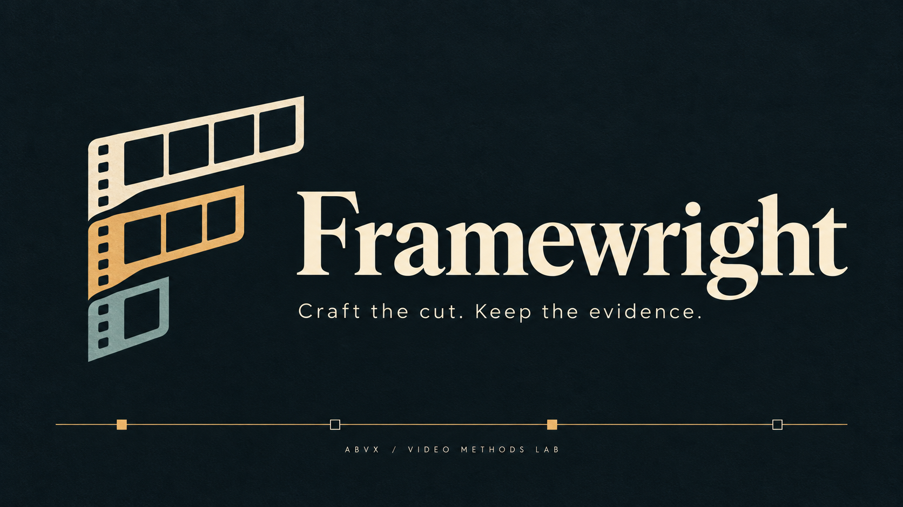

# Framewright



[](LICENSE)
[](docs/router-evaluation.md)
[](docs/router-evaluation.md)
[](experiments)

**Framewright helps an AI agent choose and execute a suitable video pipeline,
based on documented experiments.**

Framewright provides instructions and planning checks; your agent executes the
selected tools in your environment. Tested recipes and limitations guide the choice
of tools for each scene and layer.

| Start here | What you get |
| --- | --- |
| **Try a plan** — run the command below | A proposed scene-by-scene toolchain, timeline and handoff checks; no rendering |
| **[Render the reference film](docs/first-video.md)** | Open demo assets, pinned dependencies, exact commands, expected files and QA |

## Try a plan

From a local checkout, with Python 3:

```sh
python3 skills/video-production-router/scripts/plan.py examples/briefs/mixed-promo.json
```

This is a deterministic offline check of a structured brief. An agent first turns
your request into scenes and requirements; the script itself does not interpret prose.
The current command returns `status: proposed`, `execution: not_started`, 1920×1080,
30 fps and 900 frames. Selected fields from its [actual full output](examples/plans/mixed-promo.json):

| Scene | Frames, end-exclusive | Duration | Input kind | Selected tools |
| --- | --- | --- | --- | --- |
| intro | 0–180 | 6s | brand | Remotion |
| interface | 180–420 | 8s | react-ui | Flute |
| object | 420–600 | 6s | object | Anatomy → Hyperframes |
| book | 600–780 | 6s | book-art | Hyperframes + Kokoro |
| outro | 780–900 | 4s | brand | Remotion |

The input column names required source kinds, not assets already inspected.
FFmpeg is the proposed assembly owner. This combined chain needs an integration
test; individual component successes do not qualify it. The output calls for actual
codec/alpha/colour and frame-boundary checks, one master audio timeline, encoded
transition/sync/loudness/peak and thumbnail inspection, and retained export hashes.
Licence eligibility, input rights and runtime availability still need review.

## One concrete result

**Task:** a 30-second horizontal Framewright introduction.
**Chain:** Remotion scenes + original locally synthesized music → native MP4 and PNG.
**[Watch the film](https://youtu.be/s3BBP698_r8)** · **[Reproduce its source](docs/first-video.md)**

Recorded checks: H264 1920×1080, 30 fps, 900 frames, stereo AAC, native PNG, sampled
encoded frames and transitions. Human listening, artistic acceptance and audience
performance are separate. The supplied public URL was not matched byte-for-byte.
Independent reproduction in a second environment remains [queued](docs/experiment-queue.md).

## Main routes

| Request / inputs | Starting chain | Recorded limits |
| --- | --- | --- |
| Short software introduction | Brag full → Hyperframes | AsciiTheme and AMI delivered; those pilots did not test narration |
| Existing artwork with French/English narration | Hyperframes + local Kokoro + sound-layer/FFmpeg | Book trailers delivered; new languages/formats require checks |
| Camera and focus around genuine React UI | Flute → optional FFmpeg finishing | CoqPi browser-host export; Electron and snapshot CLI limits retained |
| Authored typography, scene timing and native still | Remotion | One Framewright film; licence and browser workaround documented |
| Detailed object visualisation | Anatomy → deterministic timeline adapter | Visual prototype only; combined sound QA failed |

[Recipes and evidence](skills/video-production-router/references/recipes.md) ·
[Capabilities and styles](skills/video-production-router/references/tool-matrix.md) ·
[Per-layer selection](skills/video-production-router/references/selection.md)

## Use the agent skill

For a reviewed clone in a stable location:

```sh
git clone https://github.com/markoblogo/framewright.git
mkdir -p ~/.codex/skills
test ! -e ~/.codex/skills/video-production-router && \
  test ! -L ~/.codex/skills/video-production-router && \
  ln -s "$(pwd)/framewright/skills/video-production-router" ~/.codex/skills/video-production-router
```

The link refuses to overwrite an existing skill; keep the checkout mounted and
start a fresh Codex session. Example request: “Plan a French trailer from this book
page and approved cover. Use $video-production-router. Do not render yet.”
Follow the selected renderer's own guide when execution is authorised.

## Experimental planning capabilities

For new multi-shot briefs, the [storyboard adapter](docs/storyboard-adapter.md)
establishes timings, continuity and per-scene handoffs. Existing edits, finishing
and single-shot requests can skip it. It prepares a plan, not generated footage.

[Music/song planning](skills/video-production-router/references/music-workflows.md)
covers brief → music → video, fixed video → music, and existing music → video.
Suno/Flow Music generation, lyrics and native video are documented planning
capabilities, without public service-integration qualification. Account access,
credits, export availability and asset-specific rights remain independent gates.
No new engine is needed for the current follow-up work.

## Planning checks

Current known-case regression: **70/70 rubric;62/70 complete evidence**; original first-exposure result:
**13/18**. These apply to the recorded planning configuration, not rendering quality
or general reliability. **[Evaluation details and retained failures](docs/router-evaluation.md)**.
The three retained findings pass; eight CLI trace gaps keep qualification limited. Release 0.1.1 remains experimental; no new release.

## Contribute and connect

[Record an experiment](docs/experiments.md) · [Next tests](docs/experiment-queue.md) ·
[ABVX ecosystem links](docs/ecosystem.md) · [Project page](https://abvx.xyz/work/framewright)

The repository's MIT licence covers its original materials; upstream software,
models, music and artwork have their own terms. Large media stay outside Git.

Maintenance: [one offline check command and bounded model checks](docs/checking-policy.md).
[CLI follow-up](benchmarks/router/2026-10-15/cli-capture-recovery/README.md): 8/8 affected cases now have complete traces and pass the unchanged rubric; historical full-run counts remain unchanged.
New [Burgers pilot](experiments/2026-10-15/burgers-cue-analysis.md): 15s narrated promo; librosa recovered3/3 authored accents and PySceneDetect4/4 exact cuts. [Analysis helper](examples/cue-analysis/README.md); independent listening remains pending.

[Spot-Market visual pilot](experiments/2026-10-15/spot-market-3d-miniature.md): staged Three.js grain/truck/port action and camera inside Hyperframes,20s with English narration. [Authored source](examples/staged-market-scene/README.md); technical QA passed, owner creative review pending.
