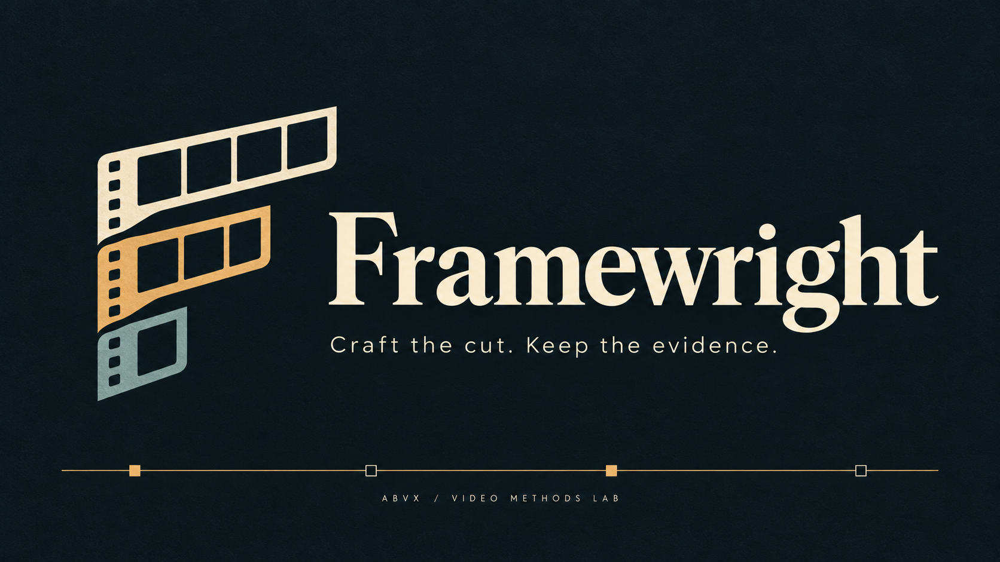

# Framewright



[](https://github.com/markoblogo/framewright/releases/tag/v0.7.0)
[](LICENSE)

**Reusable workflows and local tools for a video studio run with an AI agent.**

Plan a film, keep sources and decisions together, review exact versions and reuse
what worked. Framewright is an experimental methods/skills library: the agent runs
selected tools in your environment. It is not a hosted renderer or an automatic
publishing service.

## Start / continue / correct

| Your task | Begin here | What you get |
| --- | --- | --- |
| **Start a film** | [Brief and production proposal](docs/start-here.md#start-a-film) | A concept, available sources/gaps, feasible route, constraints and a small pilot |
| **Continue a project** | [Recover the current state](docs/start-here.md#continue-a-project) | Exact selected version, accepted work, waits/blockers and the next permitted step |
| **Correct a fragment** | [Bounded change and A/B review](docs/start-here.md#correct-a-fragment) | A precise request, preserved original and corrected version, comparison in context |

[Current priorities](docs/next-cycle.md) · [Strategic roadmap and release gates](docs/roadmap.md)

## Try one production plan

From a local checkout with Python3, without additional Python packages:

```sh
python3 skills/video-production-router/scripts/plan.py examples/briefs/mixed-promo.json --format markdown
```

This prints a plan; it does not render, install, call a model or spend money.
[Example output](examples/plans/mixed-promo.md) · [Agent setup](docs/production-guide.md#use-the-agent-skill).

## Current state

| Scope | Evidence and boundary |
| --- | --- |
| Source version | Experimental0.7.0 / REL-B; [release notes](docs/release-notes-0.7.0.md) and [publication audit](docs/release-audit-0.7.0.md). Verify actual publication at the canonical release page. |
| REL-B evidence | [Assessment](docs/rel-b-readiness-2026-11-01.md): both formats accepted, scoped recovery/reuse/correction; [local checks/review](docs/rel-b-local-review-2026-11-01.md) and PR50/merged-main CI pass. No labour-savings or whole-route-autonomy claim. |
| SSI handoff | [v2.1 template](docs/experiments/ssi-brand-profiles.md) owner-accepted; three new weekly films reported prepared, not sent/published. Partner approval and configured8November autonomous outcome remain open. |
| AzurMenton guide pilot | [40s guide film](docs/experiments/azur-guide-first-film.md) accepted; YouTube and guide embed owner-reported. A general automated guide template is not yet qualified. |

Private projects/media remain outside Git; follow the [external-storage and cleanup policy](docs/storage-policy.md).
Technical QA, creative/listening
acceptance, rights and publication are separate records. Labour savings,
whole-route autonomy and audience performance are not established by these films.

[No Further Claims character-film method](docs/methods/coherent-manga-production.md) now records
the completed131.25s manga film and native aspect-layout workflow. [REL-C assessment](docs/rel-c-readiness-2026-11-04.md)
retains one same-case cold-resume check; this documentation slice is not a new release.

## Selected results

| Film | What it demonstrates |
| --- | --- |
| [The Last Seed](https://youtu.be/ZQTORLBw9Zs) | Original Blender short with targeted contact, mechanism, rain and soundtrack corrections; [case](docs/experiments/last-seed-recovery.md) |
| Beyond the Letters — internal test | Reused sources/recipe/score, new story/voice, accepted16:9 and9:16; [repeat-production evidence](docs/experiments/rel-b-repeat-protocol.md). No publication planned. |
| [Menton: market to sea](https://youtu.be/WEEGy8Ks3ig) | Illustrated guide, owner footage, stock cutaways, route ending and expressive English narration; [case](docs/experiments/azur-guide-first-film.md) |
| [Framewright workflow lesson](https://youtu.be/n1wuySSYQcQ) | Two-host dialogue and real production examples; [case and limits](docs/experiments/framewright-micro-lesson.md) |

[Four training films → coherent fiction](docs/methods/training-to-fiction-2026-11-03.md):
accepted AI-explainer, animated-poster, liquid-photo and transport-guide cases;
reusable choices, remaining limits and three bounded next-production questions.
These are production results, not blanket tool qualifications or a new release.

Publication links and owner acceptance are owner-reported unless a case identifies
separate verification. [More experiments](docs/experiments.md) ·
[Prior detailed overview, dated history](docs/history/readme-through-2026-11-01.md).

## Test a method before production

Use the [experiment workbench](skills/video-production-router/references/trials-and-readiness.md)
for one bounded question with pinned inputs, an existing-method comparison and
separate output/review evidence. [Queue](docs/experiment-queue.md).
Free/open-source/macOS tools are preferred for this workspace; other platforms and
paid tools stay reserves. Existing subscriptions require actual access/terms checks.
[Selection policy](docs/production-guide.md#owner-preference-free-open-source-and-macos-first).

## Correct a film and reuse its design

[Revisions](skills/video-production-router/references/revisions.md) retain the
interval, defect, desired change and protected properties. [Templates](skills/video-production-router/references/templates.md)
separate design from copy/media/voice, but variants need their own render and review.
[Caption-time preflight](examples/production-reuse/README.md) flags overly short
English copy; it never silently retimes accepted films.

[Source-first editing](skills/video-production-router/references/editing.md) ·
[OTIO handoff/return](skills/video-production-router/references/otio-export.md) ·
[Saved-shot execution](skills/video-production-router/references/shots-and-passports.md) ·
[External-project handoff](docs/external-project-handoff.md) · [Production guide](docs/production-guide.md).

## Checks and contribution

```sh
python3 scripts/check.py
```

Offline checks and temporary package smoke; no model calls, installs or release.
Optional dependency skips are reported. [Checking policy](docs/checking-policy.md).
MIT for original repository materials; tools/models/media have separate terms.

[Book methods and cases](docs/book/README.md) · [English Studio Notes](docs/editorial/README.md).

## Ecosystem references

The executor draws on explicit task/checkpoint ideas also used by [SET](https://github.com/markoblogo/SET)
and behavior-first checks in [ABVX agent skills](https://github.com/markoblogo/abvx-agent-skills).
These are references, not runtime dependencies. [AGENTS.md Generator](https://github.com/markoblogo/AGENTS.md_generator)
is an optional instruction-practice reference. [ID](https://github.com/markoblogo/ID)
and [Pomerado](https://github.com/Pomerado/pomerado) remain conditional candidates.
